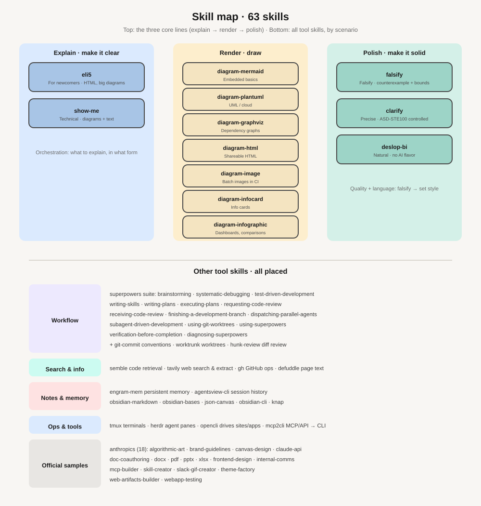
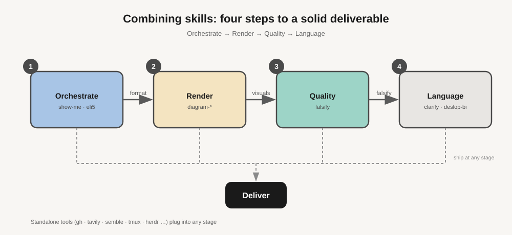

[English](./README.md) | [中文](./README.zh.md)

# skill-vault

[](./LICENSE)
[](https://github.com/Spoon94/skill-vault)
[](https://agentskills.io/specification)
[](#contributing)

> A personally collected and organized collection of **Agent Skills** for AI coding assistants, grouped by source/topic and ready to use out of the box.

Each skill is a self-contained directory. The directory holds `SKILL.md` and the resources it uses (scripts, templates, reference docs). Every skill follows the [Agent Skills specification](https://agentskills.io/specification). Any AI coding assistant that is compatible with skills — Claude Code, Codex CLI, Copilot CLI, Gemini CLI, OpenCode, and others — can load and invoke it.

## Quick start

```bash
git clone https://github.com/Spoon94/skill-vault.git
cp -r skill-vault/git-commit ~/.claude/skills/     # Claude Code + git-commit as an example
```

**See [INSTALL.md](./INSTALL.md) for the complete installation steps** (per-platform directories, symlinking, bulk installation, nested paths).

## Skill overview



Three core lines: **explaining and orchestration** (eli5 · show-me, to make people understand) → **rendering output** (7 diagram-\* skills for drawing) → **polishing delivery** (falsify for falsification · clarify for precision · deslop-bi for naturalness). The remaining tool skills fall into four categories — retrieval, workflow, memory, and operations — see the index below.

## Combining skills



Pipeline: **orchestration** (show-me / eli5 choose the explanation format) → **rendering** (diagram-\* adds diagrams as needed) → **quality** (falsify for falsification) → **language** (clarify / deslop-bi set the style). Standalone tool skills (gh, tavily, tmux, etc.) are woven into any stage as needed.

**Key points**:

- `show-me` comes with inline Mermaid and focused HTML. When its built-in diagrams are enough, do not stack `diagram-*` on top. Only upgrade to the matching `diagram-*` when you need UML / cloud architecture / DOT edge routing / finished files.
- Do not run the output of `eli5` through `clarify`. eli5 wants to be vivid, clarify wants to be plain; the two pull in opposite directions. `clarify` and `deslop-bi` are mutually exclusive: the former flattens the human touch, the latter restores it.
- `falsify` targets claims / explanations / plans, not pure rendering output. `diagram-*` only draws from a description and makes no falsifiable claims.

## Skill index (64 · by scenario)

### Explaining and drawing (14 core skills)

| Skill | Purpose |
|------|------|
| [eli5](./eli5) | For people who know nothing about it: HTML with big diagrams and few words |
| [show-me](./show-me) | For technical people: orchestrated diagrams + short text that explains a topic |
| [diagram-mermaid](./diagram/diagram-mermaid) | Embed basic diagrams (flow / sequence / state / ER, 11 kinds in total) |
| [diagram-plantuml](./diagram/diagram-plantuml) | Professional diagrams: UML / cloud architecture / network / security / BPMN (icon library of 9500+) |
| [diagram-graphviz](./diagram/diagram-graphviz) | Dependency trees / call graphs / package hierarchy, fine-grained edge routing |
| [diagram-html](./diagram/diagram-html) | Shareable HTML finished diagrams / one-page explainers, dual themes + one-click export |
| [diagram-image](./diagram/diagram-image) | Produces SVG / PNG / offline HTML / GIF animations; the command line suits CI / batch processing |
| [diagram-infocard](./diagram/diagram-infocard) | Single-topic info cards with magazine-quality layout |
| [diagram-infographic](./diagram/diagram-infographic) | KPI dashboards / timelines / SWOT / funnels / comparisons |
| [falsify](./falsify) | Falsification: force a counterexample + failure mechanism + boundaries into an artifact |
| [clarify](./clarify) | Precise delivery: rewrites both Chinese and English under the ASD-STE100 controlled language |
| [deslop-bi](./deslop-bi) | Natural delivery: removes the AI flavor and restores the human touch |
| [obsidian/defuddle](./obsidian/defuddle) | Extracts clean Markdown from web pages, saves tokens |
| [obsidian/knap](./obsidian/knap) | Batch-renders Markdown notes from templates + structured data |

### Development workflow (19)

| Skill | Purpose |
|------|------|
| [superpowers/brainstorming](./superpowers/brainstorming) | Before starting out: design exploration and requirements clarification |
| [superpowers/writing-plans](./superpowers/writing-plans) | Once there is a spec: write multi-step implementation plans |
| [superpowers/executing-plans](./superpowers/executing-plans) | Execute implementation plans |
| [superpowers/subagent-driven-development](./superpowers/subagent-driven-development) | Run independent tasks in parallel with subagents |
| [superpowers/dispatching-parallel-agents](./superpowers/dispatching-parallel-agents) | Dispatch 2+ independent tasks to parallel agents |
| [superpowers/test-driven-development](./superpowers/test-driven-development) | Before writing the implementation: write the tests first |
| [superpowers/systematic-debugging](./superpowers/systematic-debugging) | On a bug / test failure: systematic debugging |
| [superpowers/verification-before-completion](./superpowers/verification-before-completion) | Before claiming completion: verify first |
| [superpowers/requesting-code-review](./superpowers/requesting-code-review) | Before merging: request a code review |
| [superpowers/receiving-code-review](./superpowers/receiving-code-review) | After receiving review comments: evaluate first, then change |
| [superpowers/finishing-a-development-branch](./superpowers/finishing-a-development-branch) | Implementation done: finish up the development branch |
| [superpowers/using-git-worktrees](./superpowers/using-git-worktrees) | When you need an isolated working tree: use git worktree |
| [superpowers/using-superpowers](./superpowers/using-superpowers) | At the start of a session: how to discover and use skills |
| [superpowers/writing-skills](./superpowers/writing-skills) | Create / edit / validate skills |
| [superpowers/diagnosing-superpowers](./superpowers/diagnosing-superpowers) | Review a superpowers session that went wrong and generate a bug report |
| [git-commit](./git-commit) | Standardized commit messages (Conventional Commits) |
| [worktrunk](./worktrunk) | Worktrunk (`wt`) worktree management, hooks, configuration |
| [hunk-review](./hunk-review) | Work with Hunk's interactive diff review sessions |
| [anthropics/skills/skill-creator](./anthropics/skills/skill-creator) | Create / improve skills, measure skill performance |

### Retrieval and information (5)

| Skill | Purpose |
|------|------|
| [semble](./semble) | Semantic code retrieval, replaces grep+read, saves ~98% tokens |
| [tavily](./tavily) | Web search / extraction / crawling / research, with citations |
| [gh](./gh) | GitHub CLI invocation patterns: structured output, pagination, `gh api` as the fallback |
| [obsidian/obsidian-cli](./obsidian/obsidian-cli) | Read / create / search vaults through the Obsidian CLI |
| [agentsview-cli](./agentsview-cli) | Local AI session history: sync / search / cost reports |

### Notes and memory (6)

| Skill | Purpose |
|------|------|
| [engram-mem](./engram-mem) | Persistent memory across sessions (local SQLite, for both work and life) |
| [obsidian/obsidian-markdown](./obsidian/obsidian-markdown) | Obsidian Markdown: wikilinks / embeds / callouts / properties |
| [obsidian/obsidian-bases](./obsidian/obsidian-bases) | Obsidian Bases (`.base`): views / filters / formulas / summaries |
| [obsidian/json-canvas](./obsidian/json-canvas) | JSON Canvas (`.canvas`): nodes / edges / groups |
| [anthropics/skills/doc-coauthoring](./anthropics/skills/doc-coauthoring) | Structured co-writing |
| [anthropics/skills/internal-comms](./anthropics/skills/internal-comms) | Write all kinds of internal communications (weekly reports / announcements / FAQ) |

### Operations and integrations (7)

| Skill | Purpose |
|------|------|
| [tmux](./tmux) | Drive tmux from scripts: background sessions / send-keys / capture-pane |
| [herdr](./herdr) | Herdr CLI for controlling the terminal multiplexer and coordinating agents |
| [hao](./hao) | hao: tiered multi-agent collaboration — role catalog, dispatch by tier, naming / persistence, task-level waiting |
| [opencli](./opencli) | Turns websites / Electron apps / external CLIs into a unified operating surface |
| [mcp2cli](./mcp2cli) | Turns MCP / OpenAPI / GraphQL into CLIs |
| [anthropics/skills/mcp-builder](./anthropics/skills/mcp-builder) | Build high-quality MCP servers |
| [anthropics/skills/claude-api](./anthropics/skills/claude-api) | Build / debug / optimize Claude API and Anthropic SDK applications |

### Documents and design (12)

| Skill | Purpose |
|------|------|
| [anthropics/skills/docx](./anthropics/skills/docx) | Word document creation / editing |
| [anthropics/skills/pdf](./anthropics/skills/pdf) | PDF processing |
| [anthropics/skills/pptx](./anthropics/skills/pptx) | PowerPoint creation / editing |
| [anthropics/skills/xlsx](./anthropics/skills/xlsx) | Excel spreadsheet creation / editing |
| [anthropics/skills/frontend-design](./anthropics/skills/frontend-design) | Frontend visual design guidelines |
| [anthropics/skills/web-artifacts-builder](./anthropics/skills/web-artifacts-builder) | Build multi-component claude.ai HTML artifacts |
| [anthropics/skills/webapp-testing](./anthropics/skills/webapp-testing) | Test local web apps with Playwright |
| [anthropics/skills/algorithmic-art](./anthropics/skills/algorithmic-art) | p5.js algorithmic art (seeded randomness) |
| [anthropics/skills/canvas-design](./anthropics/skills/canvas-design) | PNG / PDF visual art design |
| [anthropics/skills/brand-guidelines](./anthropics/skills/brand-guidelines) | Apply Anthropic's official brand colors and fonts |
| [anthropics/skills/theme-factory](./anthropics/skills/theme-factory) | Apply themes to artifacts (slides / documents / web pages) |
| [anthropics/skills/slack-gif-creator](./anthropics/skills/slack-gif-creator) | Create animated GIFs that fit Slack |

> `anthropics/template` (a scaffold template) is not listed in the index — it is the starting point for a new skill, not a usable skill.

## Installation

**Agents read [INSTALL.md](./INSTALL.md)** — it contains step-by-step installation instructions per platform.
Humans only need to know: copy the skill directory into the platform's skills directory, or use `npx skills add <repo-url>` to install in bulk.

## Differences from the upstream projects

To keep everything usable out of the box, this repository maintains the following local invariants for vendored content. Any upstream sync must preserve them:

| # | Invariant | Reason | Scope |
|---|--------|------|----------|
| I1 | `description` ≤ 1024 characters; when it is too long, store a trimmed version | Hard limit of the pi harness; anything longer fails with `description exceeds 1024 characters` | `diagram/diagram-{html,mermaid,plantuml}` (1219/1159/1452 characters upstream; the local copies are trimmed for compliance) |
| I2 | A `description` that contains `:` / quotes or other YAML special characters must be quoted | Otherwise YAML parsing fails with `Nested mappings are not allowed in compact mappings` | `semble/SKILL.md` (not quoted upstream, quoted locally) |
| I3 | ~~Flattening of relative paths referenced inside the repository~~ **fixed upstream** | Upstream switched to flat paths in 2026-10, so no local patch is needed any more | — (formerly `superpowers/brainstorming/SKILL.md`) |
| I4 | opencli has a different structure: the 5 sub-skills under upstream `OpenCLI/skills/` (opencli-usage / opencli-browser / opencli-adapter-author / opencli-autofix / smart-search) are merged into a single `opencli/SKILL.md` + `opencli/references/` | One unified entry point that routes by task type, so that 5 skills do not all end up in the context | The whole `opencli/` directory: sub-skill frontmatter removed, and the `references/` path prefixes rewritten to the local layout (`adapter/`, `search/`) |
| I5 | opencli's strategy terminology comes in two sets (the capitalized terms of the upstream documentation layer in references vs the lowercase tags at runtime), and `SKILL.md` has to maintain a mapping table | The upstream docs are out of step with their own CLI output; locally, an agent must be able to match the terminology in references to the actual output of `list -f json` | The「术语对照」(terminology mapping) table in `opencli/SKILL.md` |
| I6 | The `diagram/` family spans two upstream collections: 4 `diagram-*` from `arch-diagram/diagram/` + 3 directories renamed to `diagram-*` from `arch-diagram/skills/` (i.e. markdown-viewer/skills) (`diagram-graphviz` / `diagram-infocard` / `diagram-infographic`; bare names upstream: graphviz / infocard / infographic) | They are all diagram skills, so keeping them in one place eases routing and discovery | `diagram/diagram-{graphviz,infocard,infographic}/` |
| I7 | The diagram family is uniformly named with the `diagram-*` prefix, unlike the bare names (graphviz/infocard/infographic) upstream in `markdown-viewer/skills` | Naming consistency within the family takes priority over upstream fidelity; it also makes them easier to locate by name | `diagram/diagram-{graphviz,infocard,infographic}/`; the next time these 3 are synced, the rename + `name` field patch has to be redone |
| I8 | In `worktrunk/reference/claude-code.md` the description of `wt-switch-create` keeps the upstream wording but carries a「本仓库未收录」(not included in this repository) note | The skill was deleted (the user does not need it) while the upstream text still mentions it; the note keeps an agent from assuming it is available | `worktrunk/reference/claude-code.md` |
| I9 | `diagram-{graphviz,infocard,infographic}` are frozen at the version from before the markdown-viewer/skills merge | In 2026-10 upstream merged these 3 (and the other sub-skills in the same repository) into a single `documd-visuals`; the original directories were deleted and the new package requires Node 18+ and Chrome; locally the old version that needs no build is kept | `diagram/diagram-{graphviz,infocard,infographic}/`; skip these 3 on the next sync |

Apart from the invariants above, the remaining content is kept identical to the respective upstream projects.

## Contributing

PRs and issues are welcome:

- Adding a skill: put it under the matching category directory, and append a row to the table in this README.
- Fixing / improving an existing skill: discuss it in an Issue first, then open a PR.
- Commit conventions: follow [Conventional Commits](./git-commit).

## License

[MIT](./LICENSE)
